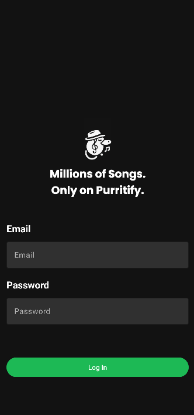
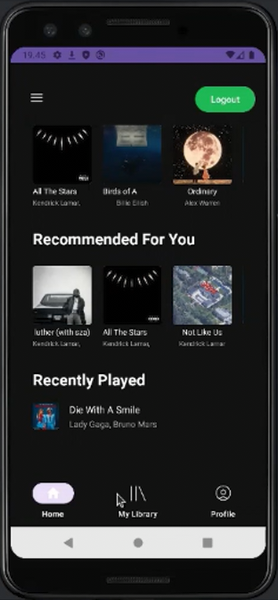
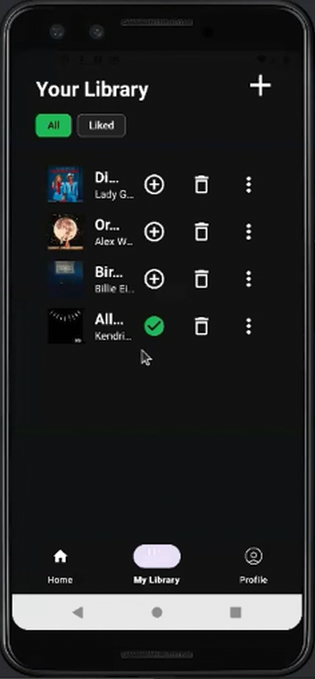

## Description
Purritify is a mobile music player app. Users can upload songs and play them within the app. Uploaded songs can be edited by their title, artist, cover, and media source. The app features a playlist which displays New Songs and Recently Played Songs. Users can mark songs as "Liked Songs" and filter songs based on their likes. The app also offers a login feature, background service, and network sensing.

## Dependencies
- KSP
- Retrofit
- Room
- Glide
- Safe Args
- Palette

## Screenshot

  
  
  
  

## Contributions
| Name | NIM | Contributions | Hours | 
|------------------------|--------------|---------------|---------|
| Ariel Herfrison        | 13522002 | Login, Navbar, Library, Penambahan Lagu, Liked Songs | 30 |
| Bastian H Suryapratama | 13522034 | Network Sensing, Background Service                  | 12 |
| Diero Arga Purnama     | 13522056 | Home, Pemutaran Lagu, Profile, Background Service    | 24 |
